> **⚠️ Disclaimer:** The **5x5 multiplier** is currently a work in progress. However, you can still use the 5x5 multipler file right now to test and observe the working of a **4x4 multiplier**.

# 5-Bit Signed Ripple-Carry Adder (Verilog)

A gate-level Verilog implementation of a **5-bit signed adder** (`AdderSign5bit.v`). The circuit accepts two 5-bit magnitude inputs along with separate sign bits, converts them into two's complement representation using combinational logic, and computes their sum via a 5-stage ripple-carry adder.

---

## Architecture Overview

The module is structured into three distinct combinational stages:

1. **Input 1 Two's Complement Converter:** Uses XOR gates controlled by `Num1Sign` to conditionally invert `Num1InBit[4:0]` and a half-adder chain (`Num1AcBit`) to add `1` when the sign bit is high.
2. **Input 2 Two's Complement Converter:** Mirrors Stage 1 for `Num2InBit[4:0]` using `Num2Sign`.
3. **5-Bit Ripple-Carry Adder:** Sums the two converted 5-bit values using one half-adder (`Bit0`) and four cascaded full-adders (`Bit1`–`Bit4`), outputting a 6-bit result (`Bit0`–`Bit5`).

```mermaid
flowchart LR
    %% Inputs
    subgraph Inputs ["Module Inputs"]
        direction TB
        N1["Num1InBit0..4<br/>Num1Sign"]
        N2["Num2InBit0..4<br/>Num2Sign"]
    end

    %% 2's Complement Conversion
    subgraph TwosComp ["2's Complement Conversion"]
        direction TB
        C1["Num1 Converter<br/>(XOR + Half-Adder Chain: Num1AcBit0..3)"]
        C2["Num2 Converter<br/>(XOR + Half-Adder Chain: Num2AcBit0..3)"]
    end

    %% Adder Cluster
    subgraph AdderCluster ["Ripple-Carry Adder Cluster"]
        direction TB
        FA0["1st Adder (Half Adder)<br/>Bit 0"]
        FA1["2nd Adder (Full Adder)<br/>Bit 1"]
        FA2["3rd Adder (Full Adder)<br/>Bit 2"]
        FA3["4th Adder (Full Adder)<br/>Bit 3"]
        FA4["5th Adder (Full Adder)<br/>Bit 4"]

        FA0 -- "CarryOutBit0" --> FA1
        FA1 -- "CarryOutBit1" --> FA2
        FA2 -- "CarryOutBit2" --> FA3
        FA3 -- "CarryOutBit3" --> FA4
    end

    %% Outputs
    subgraph Outputs ["Module Outputs"]
        direction TB
        OUT["Num1andNum2AdderOutBit0..5"]
    end

    %% Wiring
    N1 --> C1
    N2 --> C2

    C1 -- "Num1OutBit0..4<br/>(Num1AdderInBit0..4)" --> AdderCluster
    C2 -- "Num2OutBit0..4<br/>(Num2AdderInBit0..4)" --> AdderCluster

    FA0 -- "OutBit0" --> OUT
    FA1 -- "OutBit1" --> OUT
    FA2 -- "OutBit2" --> OUT
    FA3 -- "OutBit3" --> OUT
    FA4 -- "OutBit4 & CarryOutBit4 (OutBit5)" --> OUT
```



---

## Port Description

### Inputs

| Port Name | Width | Description |
| :--- | :---: | :--- |
| `Num1InBit0` – `Num1InBit4` | 1-bit each | 5-bit unsigned magnitude for Operand 1 (`Bit0` = LSB, `Bit4` = MSB) |
| `Num1Sign` | 1-bit | Sign bit for Operand 1 (`0` = Positive, `1` = Negative) |
| `Num2InBit0` – `Num2InBit4` | 1-bit each | 5-bit unsigned magnitude for Operand 2 (`Bit0` = LSB, `Bit4` = MSB) |
| `Num2Sign` | 1-bit | Sign bit for Operand 2 (`0` = Positive, `1` = Negative) |

### Outputs

| Port Name | Width | Description |
| :--- | :---: | :--- |
| `Num1andNum2AdderOutBit0` – `Bit4` | 1-bit each | Lower 5 bits of the computed sum |
| `Num1andNum2AdderOutBit5` | 1-bit | Carry-out / MSB of the 6-bit adder output |

---

## Design Notes & Hardware Limitations

* **Valid Input Range:** Because the circuit converts a 5-bit magnitude into a 5-bit two's complement value before adding, valid inputs without internal conversion overflow span **`-16` to `+15`**.
* **Sign Extension Note:** Currently, the 5-bit two's complement values are added directly without sign-extending to 6 bits prior to addition. Consequently, `Num1andNum2AdderOutBit5` reflects the raw carry-out of the 5th adder stage rather than a true 6-bit sign bit when adding negative numbers (e.g., `-1 + (-1)` produces `1_11110` where bit 5 is carry-out).

---

## How to Run & Simulate

### Option 1: DigitalJS Online (Browser)
1. Open [DigitalJS Online](https://digitaljs.tilk.eu).
2. Paste the contents of `AdderSign5bit.v` into the editor and click **Run**.
3. Toggle the input switches (`Num1Sign`, `Num1InBit0..4`, etc.) to observe real-time signal propagation.

### Option 2: Icarus Verilog (CLI)
```bash
iverilog -o sim SignAdder5bit.v tb_SignAdder5bit.v
vvp sim
```
